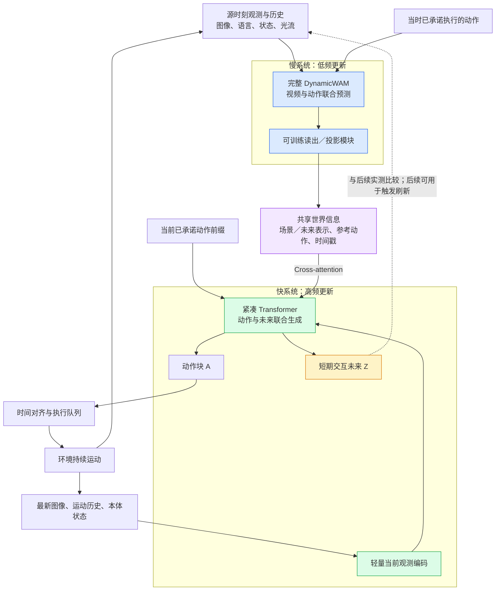
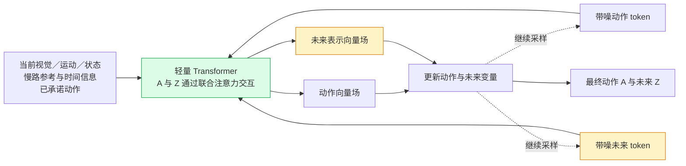
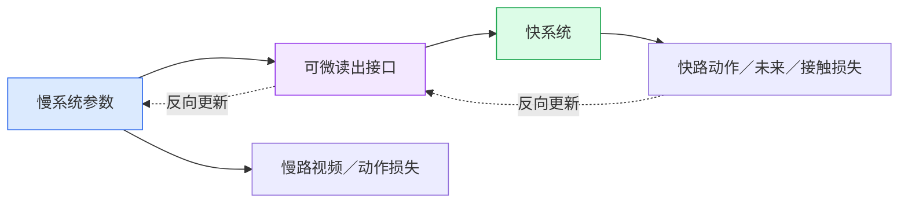
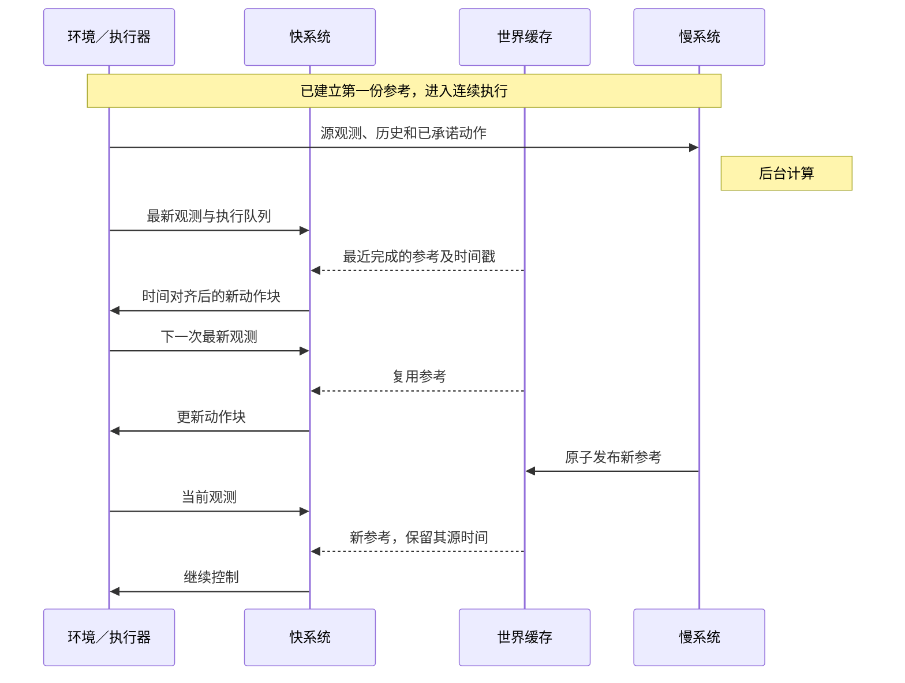

# 面向动态物体操作的双频世界—动作模型设计

版本：v1.0 · 2026-10-23
应用：DOMINO 动态操作；连续执行与真机部署
状态：研究设计，尚未实现验证。文中的频率、token 数及时间窗口是初始实验配置，不是已验证结果。

> **核心方案：慢系统低频生成丰富的世界与动作参考；快系统读取最新观测，高频联合生成紧凑的交互未来与动作。最终由快系统控制机器人。两套系统在主要训练阶段端到端联合优化。**

## 1. 最终设计一览

| 问题 | 本方案的决定 |
|---|---|
| 慢系统是什么？ | 用已训练的完整 DynamicWAM 初始化，保留 Video Expert、Action Expert 和原生联合采样结构。 |
| 快系统是什么？ | 新增轻量世界—动作模型，联合生成动作 token 与少量未来交互 token。 |
| 中间共享什么？ | 经过读出模块整理的场景／未来表示、参考动作和时间元数据；不要求共享网络参数。 |
| 如何交互？ | 快系统通过 cross-attention 读取最近完成的慢路表示，同时读取最新观测。 |
| 谁预测未来？ | 两条路都预测。慢路预测丰富视觉未来，快路预测短期、任务相关的交互未来。 |
| 执行谁的动作？ | 执行快路动作。慢路动作仅提供参考，不与快路动作直接平均。 |
| 如何训练？ | 预训练初始化，可选短暂预热，随后以联合训练为主。快路损失经过接口反向更新慢路。 |
| 最关键的假设？ | 在相同计算预算下，快速更新的交互预测能修正旧世界参考，提高动态闭环成功率。 |

**分工原则：快路减少预测内容，但保留目标位置、相对运动和接触时机的精度。**

## 2. 总体架构



**读图说明：**

1. 慢路保留 WAM 的丰富世界预测能力，输出一份可复用参考。
2. 快路每次重新观察、重新预测、重新生成动作；不会只是播放慢路计划。
3. 训练时，中间表示保留梯度；部署时，它是原子更新的缓存。
4. 第一版使用固定刷新周期。预测失配触发刷新作为后续增强，避免同时引入过多变量。

## 3. 模块与接口

### 3.1 慢系统：完整 DynamicWAM

**输入：**源时刻及以前的多视角观测、运动历史、本体状态、语言，以及该时刻已经承诺的动作前缀。

**输出：**未来视频表示、参考动作计划、可供快路读取的上下文。

**保留慢路 Action Expert 的原因：**原 DynamicWAM 的视频和动作通过联合计算相互影响。第一版保留这一结构，以减少破坏预训练能力的风险；之后再单独消融或蒸馏慢路动作分支。

**动作前缀适配是新增工作：**需要把已承诺动作作为已知条件，贯穿慢路联合生成和快路生成；不能因为原模型有联合注意力，就假定这一能力已经具备。

**未来覆盖范围：**第一版沿用检查点实际支持的窗口，不默认扩成长视频预测。快路超出慢路覆盖的部分，应标为“无慢路未来参考”。

### 3.2 共享世界信息：明确语义，不直接复用任意 K/V

| 内容 | 作用 | 必须保留的标记 |
|---|---|---|
| 观察相关特征 | 提供对象身份、任务、场景几何等上下文 | 来源、视角、源时间 |
| 预测未来特征 | 提供可能的交互过程与未来状态参考 | 对应的物理时间、有效范围、生成阶段 |
| 参考动作计划 | 帮助快路理解慢路预测所处的计划背景 | 每个动作的物理时间 |
| 缓存元数据 | 管理过期、异步到达和有效性 | 源观测时间、完成时间、版本、有效掩码 |

读出模块将选定的慢路特征投影到快路维度，并保留实体／空间与时间结构；快路通过 cross-attention 选择信息。

**实现约束：**

- 原生联合隐藏状态不天然等于“纯观察状态”或“明确未来”。应先审查实际 token 布局和注意力路径，再选择特征来源。
- DynamicWAM 的视频表示在早期联合去噪阶段形成，后续动作继续细化。因此不能宣称缓存视频必然精确对应最终参考动作。保留生成阶段信息，并通过联合训练和一致性诊断验证接口。
- 第一版不要求快路逐层修补整份旧视频 K/V。读出后的参考供快路读取，最新运动与未来由快路自行更新。
- 参考动作是软信息；已承诺动作是执行约束。两者使用不同类型标记。

### 3.3 快系统：当前感知＋动作与未来联合生成

**输入：**最新观测、历史运动、本体状态、语言条件、共享世界信息、缓存年龄、已承诺动作前缀。

**输出：**动作块 A，以及与本次生成相关的短期交互未来 Z。



**解读：**未来 token 在推理中参与动作生成，而非仅作为末端辅助输出。联合生成提供动作—结果联系，但不自动保证模型学会任意动作的因果后果；需要动作条件预测训练和相应诊断。

### 3.4 紧凑未来 Z 的具体定义

建议起点：**4 类实体 × 4 个未来时刻 = 16 个未来 token。**

| 实体 | +0.1 s | +0.2 s | +0.4 s | +0.8 s |
|---|---|---|---|---|
| 任务目标物体 | 1 token | 1 token | 1 token | 1 token |
| 目标容器／支撑面 | 1 token | 1 token | 1 token | 1 token |
| 左夹爪 | 1 token | 1 token | 1 token | 1 token |
| 右夹爪 | 1 token | 1 token | 1 token | 1 token |

每个 token 对应一个固定定义的连续目标向量：

```text
未来实体目标 = [局部视觉特征，实体位置，与相关夹爪的相对位置]
```

| 标签组成 | 如何制作 | 注意事项 |
|---|---|---|
| 局部视觉特征 | 用固定视觉编码器处理真实未来图像，再对实体区域提取特征 | 固定标签提取器；遮挡／区域无效时掩码 |
| 实体位置 | 从仿真位姿取得，转换到统一坐标系 | 只作为训练标签；按字段归一化 |
| 相对位置 | 用同一时刻目标与夹爪的位置计算 | 固定左右手与实体身份 |
| 接触标签 | 从真实接触记录取得左右夹爪接触状态 | 作为独立概率头的辅助监督 |

**实体位置和相对位置选择非冗余字段；token 维度通过固定投影或输入编码适配 Transformer。** 用固定视觉特征和归一化几何量定义生成目标，避免任意可学习目标编码器通过坍缩降低损失。

任务缺少某个实体时使用有效掩码；需要多目标、旋转或精细插入时，再验证是否增加实体、姿态或局部关键点。16 token 只是初始预算，不保证适合全部 35 个任务。

目标区域、位姿与接触标注只用于制作标签。部署只能使用实际可获得的观测；若输入仿真真值，必须单列 oracle 实验。当前视觉编码要保留空间信息，不能只使用全局池化特征。

## 4. 具体监督：每个输出都有对应真值

### 4.1 一条训练样本怎样构造

从同一条专家演示中抽取源时刻 s 和当前时刻 t，满足 t ≥ s。随机采样 t−s，模拟慢路信息的年龄。

例：数据按 10 Hz 记录，s = 2.0 s，t = 2.4 s。

| 分支 | 看见的观测 | 动作标签 | 未来标签 |
|---|---|---|---|
| 慢路 | 2.0 s 及此前历史 | 从 2.0 s 开始的专家动作块 | 源时刻之后、原生视频窗口内的真实视频 |
| 快路 | 2.4 s 及此前历史，加源时刻生成的参考 | 从 2.4 s 开始的专家动作块 | 2.5／2.6／2.8／3.2 s 的真实交互状态 |

历史输入只包含各自查询时刻已经获得的观测。动作前缀使用该查询时刻已经承诺的部分；不能把后续全部专家动作作为普通生成分支的干净条件。

### 4.2 监督与损失对应表

| 损失 | 网络输出 | 干净真值 | 主要用途 |
|---|---|---|---|
| L_sv | 慢路视频向量场 | 真实未来视频的冻结 VAE latent | 保留丰富世界预测能力 |
| L_sa | 慢路动作向量场 | 源时刻开始的专家动作 | 保留原生世界—动作联系 |
| L_fa | 快路动作向量场 | 当前时刻开始的专家动作 | 学习最终执行策略 |
| L_fz | 快路未来向量场 | 固定视觉特征与归一化空间状态组成的未来目标 | 学习紧凑交互预测 |
| L_contact | 未来接触概率 | 同时刻的左右夹爪接触标签 | 辅助识别交互阶段变化 |

**主标签均来自真实演示，不要求快路机械模仿慢路预测。** 慢路预测是条件；后续可以追加蒸馏实验，但不是首版必需项。

### 4.3 Flow matching 到底在监督什么

对视频、动作和紧凑未来的连续目标，采用相同定义：

```text
干净真值：x*
随机噪声：ε
噪声程度：σ ∈ [0,1]
带噪输入：xσ = (1−σ)x* + σε
向量场标签：u* = ε − x*
损失：预测向量场与 u* 的均方误差
```

训练时拟合向量场，推理时从噪声积分到干净输出。“用真实未来监督”指干净样本来源；并不意味着每次训练都要完整采样并解码 RGB。

连续几何与特征使用归一化后的分字段损失或权重，避免高维视觉特征淹没位置误差。接触是离散标签，使用二元交叉熵。遮挡、缺失实体、轨迹边界和已知动作前缀需要相应有效掩码。

### 4.4 增强动作—未来联系

交替使用两类训练样本：

1. **联合生成模式：**仅提供已承诺前缀，后续动作与未来均作为待生成变量。
2. **动作条件预测模式：**将真实专家动作作为干净条件，只训练其对应的未来预测。

同一观测下任意替换动作，不能继续把原演示未来当作真实标签。反事实动作需要仿真重放或额外采集产生对应结果；成功演示也不能替代恢复数据。

## 5. 联合训练与梯度路径

### 5.1 训练阶段

| 阶段 | 更新哪些参数 | 作用 |
|---|---|---|
| 初始化 | 加载已训练 DynamicWAM；初始化快路与接口 | 复用已有能力 |
| 可选短暂预热 | 暂时固定慢路，训练新增接口与快路 | 防止随机模块的大梯度扰乱预训练模型；不是最终训练方式 |
| **主要联合训练** | **慢路 Video／Action Expert、运动模块、读出接口、快路一起更新** | 学习跨时间、跨表示协作 |
| 后续加速 | 按实验决定蒸馏对象与冻结范围 | 在功能成立后减少采样步数 |

VAE、语言编码器及用于制作未来标签的视觉编码器可按初始化方案保持冻结。冻结这些辅助编码器，不等于冻结慢系统。建议慢路较小学习率、新增模块较大学习率；具体数值与损失权重需验证，不直接照搬其他论文。

### 5.2 联合目标

```text
L_total = λsv L_sv + λsa L_sa
        + λfa L_fa + λfz L_fz + λc L_contact
```



**关键：**快路损失通过接口回到慢路，使慢路不仅预测得合理，还学会提供快路需要的信息。若缓存永久离线固定，或在接口处全部 detach，就不是此处定义的端到端联合训练。

### 5.3 两种慢路前向必须区分

| 前向 | 可以读取真实未来加噪结果吗？ | 用途 |
|---|---|---|
| 慢路 flow-matching 监督前向 | 可以，这是去噪训练输入 | 计算 L_sv、L_sa |
| 向快路提供世界参考的预测前向 | **不可以** | 从源时刻可知条件和随机噪声生成部署一致的参考 |

**不能把含真实未来信息的监督前向特征，直接当作部署缓存交给快路。** 否则产生未来信息泄漏和训练／部署差异。

主要联合训练需要对预测前向保留可微路径；完整采样展开会增加计算和显存。实现时可使用梯度检查点，并让一个慢路预测服务多个较晚快路样本。若采用截断梯度或缓存混合训练，应明确梯度范围并做消融，不能声称与完整端到端训练等价。

## 6. 快慢预测怎样协作

### 6.1 三条交互规则

| 规则 | 具体行为 |
|---|---|
| 同一物理时间对齐 | 快路预测 t+h，读取慢路对同一个 t+h 的参考，而非相同帧序号。 |
| 最新证据优先 | 当前观测显示目标改向或接触改变时，允许快路降低旧未来的作用。 |
| 区分参考与承诺 | 慢路参考动作可以偏离；推理期间必然执行的动作前缀必须被纳入预测与动作续写。 |

例如慢路在 0 s 开始计算，0.4 s 返回，其“0.6 s 状态”对当前快路只意味着未来 0.2 s。已过期参考只可用于误差分析；超出覆盖范围不得假装仍有有效未来。

快路需要输入缓存年龄、预测时间和参考动作。参考计划变化可能使动作相关预测失效，因此不对新旧未来施加无条件一致性约束。

### 6.2 移动杯子的例子

| 实际变化 | 慢路参考的作用 | 快路需要重新预测 |
|---|---|---|
| 杯子按原速度右移 | 保留目标、接近方向与任务阶段 | 拦截位置与闭合时机 |
| 杯子突然减速 | 任务意图仍可用，旧轨迹可信度下降 | 新位置、相对距离和动作幅度 |
| 接触后杯子滑脱 | 旧“即将抓稳”预测失效 | 接触状态和目标新运动 |
| 新慢路参考完成 | 更新较完整的世界参考 | 仍然基于当前观测控制，不能回滚状态 |

快路检测到失误不代表已经会恢复。恢复能力需要包含失败后纠正动作的数据与单独评测。

## 7. 部署：谁出动作，何时切换

**机器人只执行快路动作。** 慢路动作作为参考输入；不直接平均两套动作，也不在没有单独验证时自动切换成慢路控制。



执行规则：

1. 快路查询开始时，记录观测时间和执行队列快照。
2. 将推理期间预计必然执行的前缀作为已知条件。
3. 输出返回后，按真实经过的物理时间丢弃已经过时的动作部分，从当前对应位置续接。
4. 保持动作索引、相机时间、运动历史与仿真物理时间一致。
5. 定义并记录迟到、缓冲耗尽、参考过期时的处理，不能静默重放旧动作。首版可沿用已有 RTC 的处理，但必须统一所有基线。

### 初始配置与性能约束

| 项目 | 首版建议 |
|---|---|
| 动作空间／归一化 | 沿用 DynamicWAM，避免同时更换控制接口 |
| 动作块 | 先沿用 16 步；执行前缀长度单独扫描 |
| 快路未来 token | 先试 16 个，配合实体／时间有效掩码 |
| 快路查询间隔 | 可扫描 1／2／4 个控制步；必须由实际端到端延迟判断可行性 |
| 慢路刷新 | 固定周期起步，保证参考有效范围与快路窗口的覆盖关系 |
| 采样步数 | 先用足够步数验证机制，再减少步数或蒸馏 |
| 调度与 GPU | 明确单卡竞争或双卡隔离；相同资源下比较 |

**token 少不等于模型一定快。** 需要测量视觉编码、光流、读出、采样、通信和排队的总成本。新的观测到对应动作真正生效的时间，是比模型单次查询耗时更直接的指标。

## 8. 最小实现与验证顺序

### 8.1 实现顺序

1. **检查数据与接口：**确认位姿／接触标签、时间单位、动作定义及相机对应；检查慢路 token 布局。
2. **验证紧凑未来标签：**可视化真实与预测目标轨迹、接触事件，先判断所选表示是否覆盖任务需要。
3. **零缓存年龄联训：**慢快路从同一时刻观察，验证新增快路、表示和梯度路径。
4. **跨时间联训：**随机缓存年龄与动作前缀，逐渐扩大分频范围；加入缓存丢弃，让快路具有参考缺失时的能力。
5. **连续执行评测：**统一执行协议，测试延迟与缓存年龄敏感性。
6. **功能成立后加速：**CUDA Graph、采样蒸馏与事件触发分别开展，不与核心架构一起一次性更改。

### 8.2 必需对照

| 对照 | 要回答的问题 |
|---|---|
| 原 DynamicWAM，统一连续执行协议 | 改造后的整体收益是否真实？ |
| 快路只生成动作，无慢路参考、无未来 Z | 仅靠快反应能做到什么程度？ |
| 慢路参考＋快动作，不生成 Z | 高频未来预测是否必要？ |
| 快动作＋Z，不使用慢路 | 慢路是否提供不可替代的信息？ |
| 完整双频方案 | 两个时间尺度是否互补？ |
| 未来仅做辅助监督，不参与动作生成 | 增益来自推理时预测，还是训练正则化？ |
| 冻结慢路 vs 联合训练 | 快路梯度更新慢路是否有效？ |

优先固定数据、快路容量和优化预算；对显著改变计算量的对照，同时报告时延，避免把增益误归因于结构。

### 8.3 需要报告的指标

- **任务：**SR、MS、逐任务结果；首次接触成功与接触后恢复分开统计。
- **预测：**分时间跨度的位置／相对位置误差、局部特征误差、接触识别指标；接触前后分开分析。
- **系统：**观测到动作生效延迟、查询耗时分布、缓存年龄、缓冲耗尽比例、动作边界连续性。
- **鲁棒性：**缓存年龄、外加延迟、物体速度与运动变化扫描。
- **协议：**同一任务／种子／数据／检查点规则；原生 DOMINO 同步结果与连续执行结果分表报告；记录仿真时间与墙钟时间比例。

联合预测不等于已经学会因果动力学。应在可重放仿真状态下改变动作，比较预测与实际后果；训练集中没有的随机失误和恢复不能仅靠现有监督保证。

## 9. 风险与设计边界

| 风险 | 诊断／处理 |
|---|---|
| 快路忽略慢路 | 移除、打乱、替换参考，观察动作与成功率变化；不要只看 attention 图。 |
| 快路忽略未来 Z | 比较联合生成、辅助监督和无未来三组。 |
| 陈旧预测压制新观测 | 时间标记、年龄随机化、缓存丢弃，分年龄评测。 |
| 位置表示无法覆盖旋转／插入 | 按任务类别检查误差，按需增加姿态或局部几何。 |
| 新接口破坏预训练能力 | 先零年龄验证，再增加分频；采用较小慢路学习率并监控慢路预测。 |
| 标注或监督泄漏 | 真值只制作标签；快路缓存来自纯预测前向。 |
| 联合训练显存／计算过高 | 梯度检查点与一个慢样本对应多个快样本；任何截断梯度方案明确披露。 |
| 高频查询反而增加排队延迟 | 测量端到端反应时间与 GPU 竞争，调整查询周期。 |

**尚待代码审查与实验确定：**读出的具体层与 token、快路宽度／层数、标签特征编码器、损失权重、刷新周期、采样步数，以及动作前缀的实现方式。本设计不声称这些超参数已经优化，也不保证自动超过现有模型。

## 10. 相关工作与选型依据

| 工作 | 本方案借鉴的机制 | 区别／边界 |
|---|---|---|
| [DuoCore-FS，星尘智能，2025.12](https://arxiv.org/html/2512.20188v1) | 缓冲连接快慢路；先预训练后跨时间联合训练 | 本方案进一步让快路预测紧凑交互未来。 |
| [AHA-WAM](https://arxiv.org/html/2606.09811v1) | 世界上下文复用、观测引导读取、时间偏移训练 | 不直接把复用旧世界表示等同于更新了未来。 |
| [DynamicWAM](https://arxiv.org/html/2608.00793v2) | 历史光流、运动条件、世界—动作联合建模 | 作为已跑通的底座；新增跨周期快路和紧凑未来。 |
| [EagleVLA，原 Jetson-PI](https://github.com/PKU-SEC-Lab/EagleVLA) | 在 π₀.₅ 上根据已承诺动作预测执行时刻表示 | 支持动作条件与时间对齐设计。 |
| [Streaming-WAM](https://arxiv.org/html/2609.28927v1) | 已承诺动作同时影响视觉预测和动作续写 | 支持统一前缀条件；本方案另有快慢预测分工。 |
| [DreamCan](https://arxiv.org/abs/2610.24981) | 稀疏、可复用、具有控制用途的视觉子目标 | 本方案的快路还要更新短期动作相关未来。 |
| [TrajWAM](https://arxiv.org/html/2610.25763v1) | 预测目标掩码轨迹，引导未来视觉生成 | 与目标运动预测直接相关；不据此宣称本方案独创目标预测。 |
| [Event-Aligned WAM](https://xiaomeng-yang.github.io/Event-aligned-WAM/) | 交互事件组织视觉预测与执行有效性 | 支持将接触与任务事件作为重点监督；可作为外部强基线。 |

### DOMINO 基线选择（截至 2026-10-23 的公开信息）

| 模型 | 报告 SR / MS | 选型判断 |
|---|---|---|
| DynamicWAM | 38.20 / 53.20 | 已有本地复现和数据管线，作为研发底座。 |
| Event-Aligned WAM | 42.83 / 55.92 | 有推理代码与 DOMINO 权重，值得补测；训练／数据准备代码尚待发布。 |
| TrajWAM | 43.54 / 54.07 | 重要相关工作；代码仍 coming soon，且论文评测包含仿真接触信号。 |
| Long-WAM | 34.90 / 45.10 | 历史建模与部署参考；公开默认 DOMINO 评测配置与本地不同。 |

这些是不同论文各自协议下的报告值，不是统一复现实验排行榜。不能直接把它们与本地连续执行结果比较，也不能称 DynamicWAM 为已确认的当前最强模型。

开源状态与评测入口：[DynamicWAM](https://github.com/Autumn1337/DynamicWAM) · [Event-Aligned WAM](https://github.com/Xiaomeng-Yang/Event-aligned-WAM) · [TrajWAM](https://github.com/KevinGeng3/TrajWAM) · [Long-WAM](https://github.com/NVlabs/LongLive/blob/main/Long-WAM/README.md)

**需要最终证明的研究结论：在可比资源和连续执行条件下，低频丰富世界参考与高频紧凑交互预测能够互补，使机器人更及时地修正动作，并提高动态操作表现。**

---

图示采用 Mermaid。使用支持 Mermaid 的 Markdown 查看器可直接渲染；不支持时仍可阅读图代码与配套表格。
