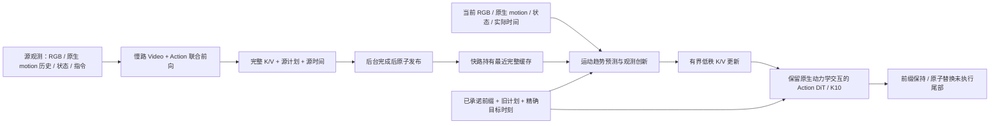

# Route1：异步联合 MotionKV v3

工作树：`/SSD_DISK/users/wuruihan/DynamicWAM/worktrees/joint-motionkv-20261015`，分支 `feat/route1-async-joint-v3-20261015`。本轮目标是完整候选代码、真实数据准备和可验证的 smoke；不启动正式训练，不修改正在评测的主仓库或 Route2。

## 为什么需要这次大改

上一版的主要缺口不是再加一个模块，而是慢路表征、快路目标和执行时钟没有形成同一个训练问题。专家帧偏移不等于真实缓存发布；旧视频 latent 的帧间隔不等于新动作物理网格；旧计划预测也不等于真实执行前缀。慢路串行刷新还会把最慢的世界模型直接放到 H4 截止时间内。

这次把时序、数据、联合损失、发布调度、RTC 队列和 checkpoint 契约一起改。CPU 验证只能证明这些路径的局部正确性；完整 Video DiT、CUDA 并发和闭环收益仍必须实测。

## 输入到输出

慢路保留原生 Video/Action 的交互，输出本次生成步骤下的 K/V 和源计划。类 OVCR 更新器读取当前观测，使用原 DynamicWAM 层级的 motion 表示；新增小型趋势预测器从源 K/V、源运动与经过时间预测当前运动，再以“当前实测运动减预测运动”形成创新。RGB 变化、计划变化、已承诺动作也作为有界更新条件。缺失运动维度必须屏蔽，不把零值当真实静止。

慢路也要使用**源查询时已经承诺的动作前缀**：两次 video/action 联合步骤都保持该前缀、赋予 clean token 时间，后续未知动作继续生成。源视频 FM 同样按这个条件训练，源 action FM 只监督未承诺后缀。source prefix 与当前快路 prefix 分开；不能把晚到的当前前缀泄漏给旧 source。这一项使世界预测考虑已确定的机器人运动，对应 [Streaming-WAM](https://github.com/SJTU-DENG-Lab/Streaming-WAM) 的 action-conditioned future 思路。

Video DiT 用源时刻未来视频监督学习整体场景演化；趋势头用当前原生运动统计监督；Action DiT 保留原生 motion tokens 和 video/action attention。这里没有把新趋势头声称为完整物理引擎，也没有用一个光流向量替代原生视频动力学。

## 训练数据与 recipe

动作标签统一到 episode 的 **0.16 秒物理网格**。机器人记录是 drive target；手臂按时间线性插值，夹爪按上一命令保持。RGB、motion 历史、源/当前 capture 时间保留实值，未来信息只用于监督。源计划按物理目标时刻对齐，超出覆盖区间则 mask；所有时间保持 float64，避免 bf16 使夹爪端点错位。

全量审计：10,500 集、原 1,420,472 样本，新网格可用 **1,416,299**；4,173 个样本因 episode 尾部不足 2.56 秒剔除。原 9,450/1,050 train/validation episode 分割保留。缓存年龄、源发布延迟、query phase 和 RTC 前缀来自同一次联合采样。它是因果一致的离线近似，不能称作已经覆盖真实部署分布。

未来视频必须重新编码：当前帧加 8 个未来帧，未来间隔 0.32 秒；使用原生 VAE 预处理，9 帧编码后去掉首 latent，得到 `[48,2,12,10]`。完整缓存需绑定原始索引、VAE、编码器、数据分割和所有分片 hash。**当前仅索引及真实 CPU 输入/标签完成，新 VAE 缓存未生成。**

| 阶段 | 参数更新与目的 | 初始候选预算 |
|---|---|---|
| 接口 warmup | 慢路冻结；训练 Action、native motion 与更新接口，稳定新时间条件 | 2,000 steps |
| 联合适配 | Video、Action、motion、接口共同训练；快路 suffix FM + 源 video/action FM + 趋势辅助损失 | 18,000 steps |
| 真实轨迹 refinement | 使用开发场景的同轨迹真实观测、旧队列和实际执行前缀；低学习率联合调整 | 2,000 steps，数据未就绪 |

这些预算是候选配置，不是已验证最优。旧时间网格 teacher 不再充当新网格监督。VAE/T5 冻结；K10 保留；没有无训练地改成 K2。

真实 replay 必须保存 actual capture/执行时间、source/current 观测、历史 queue、已执行 drive targets 和后续实际轨迹；先归一化再训练。成功轨迹的动作可做明确标注的 self-imitation；失败轨迹不能无条件当专家动作标签。开发场景与正式 700 场景按身份/hash 排除。启动 hold 的首个 query 需要真实记录：`delta_actions=0` 但 `elapsed_seconds>0`，前缀为实际 hold。不能通过修改专家 prefix 人工制造这个状态。当前尚无这批真实数据，因此该阶段与分布验收仍未完成。

缓存发布事件能记录真实 monotonic 时间，但不能仅凭进程收包时的仿真时间推断精确发布物理时刻；replay 保留物理上下界并标记非精确。当前模型使用实际 source/current capture 差和真实 prefix，不把这个上界伪装成精确延迟。启动后的真实队列网格 origin 也必须保留，不能强行重新对齐到专家 episode 的零点。

## RTC 与异步推理

部署使用独立 v3 协议，目标 **1× 连续世界**，H4/R4、chunk16、K10、每16动作触发慢路。慢路单个在途任务，额外请求只保留最新；完整快照发布后快路才可见。快路可以连续使用旧缓存，不等待正在计算的慢路。缓存同时受31动作和4.96秒上限约束，过期显式失败。

初始化时先连续推进世界并建立慢路；首个慢路动作计划不直接执行。建立真实 hold 队列后重新取观测，快路在 hold 的 H4 截止前生成首个可执行后缀。初始化耗时、hold 和相机开销均计入真实时间/预算。

每次查询提交时固定前缀与 generation；返回结果只能替换尚未执行的尾部，已承诺动作不变。训练使用 clean prefix、prefix mask、suffix loss；旧计划是软条件，未强行把所有新动作投影回旧轨迹。这样保留连续性，同时允许动态物体改变后续动作。过期 generation、真实 H4 miss、未来缓存和跨 episode 缓存都拒绝。

## 物理加速

保留原 CUDA Graph、native attention、K/V 缓存、源视觉缓存、光流对缓存。慢路与快路使用独立模型可变状态和 CUDA stream/event；快路只等待自身工作，移除会等待整个设备的同步。生产者完成自身事件后发布，异常路径也先结束自己的在途工作。稳定运行阶段禁止动态重新 capture，以免与慢路冲突。

`torch.compile` 不作为未经验证的默认开关；是否叠加应由实际 eager/graph/compile 对照决定，检查数值误差、编译次数、峰值显存以及端到端 p95/p99。单算子提速不能代替 capture→可执行动作的闭环时延。

对照 [Efficient-WAM](https://github.com/jiajun613/Efficient-WAM) 的紧凑视频/低分辨率未来表征/非对称去噪，以及 [RealtimeWAM](https://arxiv.org/abs/2610.06617) 的异步和单步方向，本轮先保留当前骨干与采样预算，把后台并发、缓存和图执行接通。单步推理需要额外训练与验收，不能直接减少采样步数并宣称等价。后续若 p99 仍超限，蒸馏或更低成本未来表征应作为独立改动和消融。

## 审查结论与验收

已由数据、模型与系统三个方向交叉检查，修复了：旧 latent 时间语义、源监督错位、无效 motion 伪创新、null cache 泄漏、浮点时间导致夹爪错位、缓存未完成发布、设备级同步、过期 queue generation、启动计划时间过期，以及旧协议报告混入 v3。

仍有必须用实验回答的问题：

1. 原生视频监督跨度2.56秒，而允许缓存年龄4.96秒；高年龄缓存是历史表征，需要检查趋势外推与长尾成功率。默认不把预训练视频节奏直接拉长。若需覆盖最大年龄加完整快路 horizon，8帧×0.96秒才覆盖7.68秒，应另建缓存并作成对消融。
2. 真正并发是否降低闭环 p99，是否与渲染争抢资源，完整联合反传是否满足显存预算：尚无 GPU 证据。
3. 真实策略前缀、启动 hold 和成功筛选偏差：代码接口不能代替真实轨迹。必须在独立开发场景收集、审计后训练；不能从正式测试集反向取训练数据。

资源释放后的顺序是：新 VAE 8分片少量编码检查 → 完整编码和 CPU hash/覆盖验收 → 8卡 warmup/joint 各4步及严格 reload → 真实 CUDA Graph 数值/并发检查 → 1×连续开发闭环与 MP4 → replay 数据与 refinement smoke → 固定正式训练配置。各阶段保留失败，不自动重试，不安装巡检，不触碰驱动恢复。

正式效果需要同协议、同任务/场景/种子的对照：联合/冻结慢路、motion创新开/关、真实replay开/关及缓存年龄分桶。旧29任务41.72%、旧0.25×评测和新1×结果不能直接混成增益。有限审查无法证明“没有任何更好的方案”；只有实测通过后，才能说当前没有已知阻塞缺陷并具备正式训练条件。

## 设计参考

[DynamicWAM 原代码](https://github.com/Autumn1337/DynamicWAM)用于保留原生运动与世界/动作交互；[AHA-WAM](https://arxiv.org/html/2606.09811v1)启发异步条件更新；[Training-Time RTC](https://arxiv.org/html/2512.05964v1)支持训练时前缀条件化；[RTC](https://arxiv.org/html/2506.07339v1)用于理解已执行前缀、重叠和实时约束。具体v3实现与数据契约以本仓库和实际测试为准，不等同于复现上述工作。
