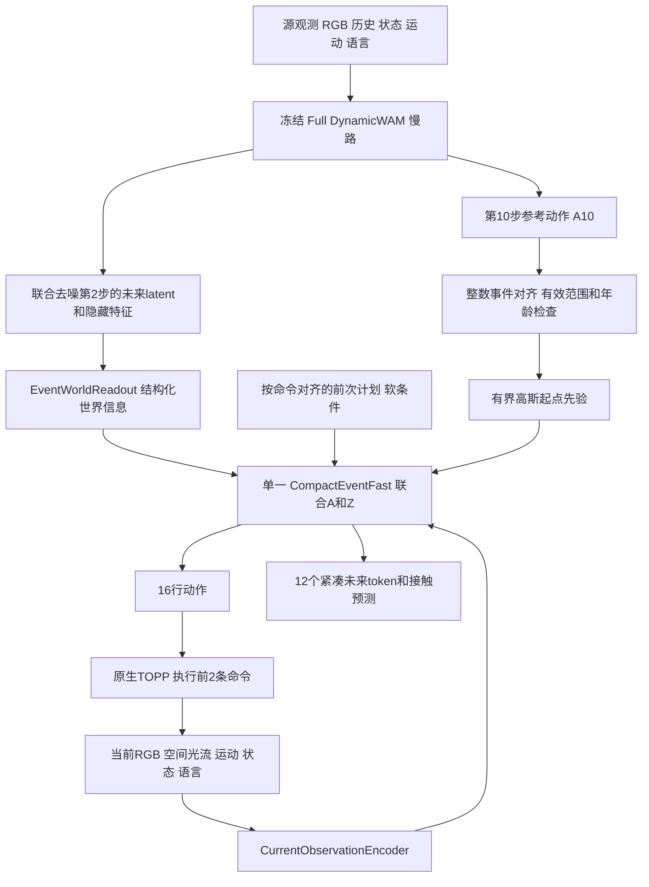

# DualRate Compact V7：代码实现、版本调整与评测记录

发布记录日期：2026-10-31（Asia/Shanghai）。本文对应训练代码提交
`4f3b91e66d61575b675d0d12dd9be1f2caaa46e2`。发布分支只补充文档和结果，未修改正在训练的代码。

**当前 V7 尚在训练，没有完成正式 35×20 评测。** 本次加入的完整评测是旧 V4 最终权重在连续仿真中的结果：57/700，SR 8.142857%。旧 Full 对照为178/700，SR 25.428571%。不能把旧 V4 成绩写成 V7 成绩，也不能把工程烟测当成性能验收。

- 当前原始代码分支：`feat/dualrate-compact-v7-20261030`。
- 带本文和结果的发布分支：`release/dualrate-compact-v7-20261031`。
- 上一版 V6：`c03b097fd36cff8fd9aca473c85794e427fce24c`，已安全停止，旧权重与日志保留。
- [历史版本及全部发布引用](HISTORY.md)、[评测汇总与逐任务表](../experiments/20261031/README.md)。

## 1. 相对 V6 改了什么

| 部分 | V6 | V7 |
|---|---|---|
| 执行动作的快模型 | 原生768维、12层Action Expert+motion及O/M/Z适配，共约150.5M | 单一448维、6层、7头联合A/Z Transformer，27,694,946参数 |
| 原生动作专家权重 | 复制到快路主干 | 不复制到不同维度快路；Full保留在冻结慢路/教师中 |
| 原生视频K/V | 快路原生motor使用 | `conditions()`删除`native_video_cache`，紧凑快路通过结构化M获取信息 |
| A10 | 当前查询教师监督；不作为旧动作推理先验 | 保留教师监督，并增加严格对齐的有界噪声先验和弱参考一致性损失 |
| 前后查询噪声 | 部署共享动作底噪，配对训练曾独立采样 | 训练与部署均按重叠命令事件共享动作底噪 |
| 采样 | 原生shifted K10 | 相同K10时间网格；增加紧凑快路CUDA Graph及独立eager对照 |
| 数据、观察编码、慢路、执行器 | 原生事件契约 | 沿用V6；没有切回连续执行器 |

384维/6层原轻量快路约20.41M。V7只增加宽度，不同时增加层数、另接第二动作生成器或直接部署完整原生motor。448维、7头使每头64维。参数数目是快路自身，不包含完整慢路及独立当前观测编码器。

**从Full起点训练不代表快路具有Full性能下界。** V7快路是新初始化的网络，其能力来自专家动作监督和Full教师辅助；没有逐值继承原生Action Expert，也没有完成一步蒸馏。

## 2. 模块与实际信息流



| 文件/入口 | 作用 |
|---|---|
| [`factory.py::build_system`](../../src/dynamicwam/dualrate/factory.py) | `native_v7`优先分支构建`CompactEventFast`和`EventWorldReadout`，绑定V7训练目标与V6事件契约 |
| [`slow.py::SlowReferenceAdapter.sample_reference`](../../src/dynamicwam/dualrate/slow.py) | 源观测独立噪声预测；导出第2步未来信息，继续动作采样到第10步 |
| [`native_v6.py::EventWorldReadout`](../../src/dynamicwam/dualrate/native_v6.py) | 原观测隐藏token与未来隐藏+latent patch投影，保留空间、时间、生成阶段元数据 |
| [`fast.py::CurrentObservationEncoder`](../../src/dynamicwam/dualrate/fast.py) | 每次查询编码最新空间RGB、运动/状态/语言与局部光流 |
| [`native_v7.py::CompactEventFast`](../../src/dynamicwam/dualrate/native_v7.py) | 处理原生命令事件和物理年龄，预计算两类cross-attention上下文 |
| [`fast.py::_JointBlock/FastJointWAM`](../../src/dynamicwam/dualrate/fast.py) | A/Z联合self-attention、当前观测attention、门控慢参考attention及输出头 |
| [`native_v7.py::aligned_reference/training_loss`](../../src/dynamicwam/dualrate/native_v7.py) | A10软约束、教师监督、尾段mask、配对重规划和续接损失 |
| [`system.py::sample_fast`](../../src/dynamicwam/dualrate/system.py) | 同一噪声先验、K10联合A/Z采样，eager或Graph后端 |
| [`fast_graph.py::FastGraphSampler`](../../src/dynamicwam/dualrate/fast_graph.py) | 仅捕获联合采样核心；每次查询复制全部动态输入 |
| [`native_v7_deployment.py::NativeDualRatePolicy.step`](../../src/dynamicwam/dualrate/native_v7_deployment.py) | 原生TOPP执行、物理时钟记录、快2/慢4或TTL刷新、命令账本 |
| [`native_v6_data.py::EventDataset`](../../src/dynamicwam/dualrate/native_v6_data.py) | 相邻两命令事件的训练配对，前次模型计划仅为软提议 |

### 2.1 慢路输出不是三套重复编码的图像

慢路保持完整Full的Video+Action+motion，采用源观测条件的2+8采样。`EventWorldReadout.forward()`要求`provenance=source_only_independent_noise_prediction`：

1. 对`source_tokens`归一化、投影，加入源空间元数据。
2. 将`future_hidden`与`latent_patches(predicted_video_latent)`拼接投影，加入空间坐标、预测事件范围和`prediction_sigmas`。
3. 组成384维`world_tokens`，附`world_valid/world_types/world_intervals`及源时刻、完成时刻、源命令序号。
4. `reference_actions`保持独立的归一化A10数组，供软先验与监督使用，不混入通用attention token。

本版快路读的是**结构化的隐藏特征与预测视觉latent**，并不要求解码完整未来RGB视频。快路每层计算的M K/V来自这些投影token，不是直接沿用Full Action Expert的原生K/V。早期视频与最终A10来自不同去噪阶段，不能声称已经证明两者与后续快路修正后的轨迹完全一致。

### 2.2 当前观察编码与紧凑A/Z网络

当前编码器输出384维token：预训练ResNet18 stage3、stride16空间RGB patch，加坐标、视角、有效像素覆盖与时间特征；另编码归一化运动、本体状态、语言及4×4局部光流。保留空间布局，不只是全局池化向量。

快路输入为`A:[B,16,14]`及`Z:[B,12,134]`，再加去噪sigma与查询条件。每个block依次执行：

1. 28个A/Z token的联合self-attention，Q/K归一化。
2. 对当前观察及前计划token的cross-attention。
3. 对M的独立cross-attention；`slow_gate`读取当前条件、最新观察attention响应及偏差信号，调节旧信息的影响。本版原生零承诺模式的偏差信号为0，仍保留当前观察门控。
4. FFN与残差。

输出一个14维动作速度场头、134维未来速度场头，以及2维接触logits头。只有一个动作decoder。Z通过联合注意力影响动作，但还没有实现利用Z与真实后续观测的预测误差来触发慢路刷新。

Z对应`tracked_dynamic_target / left_gripper / right_gripper`三类实体，各4个未来事件`+1,+2,+4,+8`。134维为128维局部未来视觉特征、3维位置、3维相对位置；接触另作辅助概率头。缺失标签按字段mask。没有伪造独立support位姿、真实可见性或遮挡监督；视觉标签是投影局部图像上下文，可包含遮挡物。

## 3. A10约束、动作续接与训推一致性

令源命令号为`s`，当前查询命令号为`q`。`align_plan()`用`q-s+arange(16)`直接gather，越界行清零并置无效，不复制最后一行，不以浮点秒数猜测动作行。

`aligned_reference()`进一步屏蔽缺失参考、参考物理年龄>1.44秒以及已知前缀。令`age=t_query-t_source`，对有效机械臂坐标：

```text
weight = 0.15 * exp(-age / 0.72)
center = weight * clamp(aligned_A10, -3, 3)
center[..., gripper_indices=(6,13)] = 0
noise = standard_Gaussian + center
x_sigma = (1-sigma)*expert_action + sigma*noise
velocity_target = noise - expert_action
```

训练和推理共用这个先验函数。它是可被网络改变的有界起点偏置，不是将最终快慢动作平均，也不是强制执行慢路计划；模型本身仍可能学会忽略它。原生同步模式没有推理期间必须执行的前缀，`fast_known_mask/source_known_mask`均为0，并有程序断言。

`training_loss()`保留以下目标：

| 项 | 实现/权重 |
|---|---|
| 专家动作FM | 主目标；真正执行的前2行权重4，其余1；无真实标签的终端后缀不计损失 |
| 当前查询Full教师 | 用当前查询观测、相同命令起点重新生成A10，约束`clean=x-sigma*v`，权重0.1 |
| 旧A10参考一致性 | 对齐后的有效机械臂字段，权重0.02，再乘上述年龄系数；排除夹爪 |
| 专家动作差分 | 预测相邻动作差分与专家差分之差，权重0.05；不是强迫速度为0 |
| 上次计划续接 | 前次学生计划按事件移位后的重叠区，权重0.05；仅机械臂、只作软目标 |
| Z与接触 | 视觉FM 0.25、几何FM 1.0、接触BCE 0.1；使用真实监督mask |

教师/旧参考/续接分别使用与专家动作的误差置信门控（`exp(-MSE/0.25)`），避免无条件强制跟随不兼容计划。教师目标是完整Full采样结束后的动作块，但学生端是随机sigma的一步clean估计；**这不是已经完成的完整学生采样终点蒸馏或一两步RealtimeWAM式推理**。

配对训练用`overlapping_noise()`为同一命令事件复用高斯动作噪声；部署`ordinal_action_noise()`按episode seed和命令号生成相同对应关系。前计划投影后保存，随后通过`previous_actions/previous_valid`作为软条件。部署仍按真实URDF/夹爪范围投影；动作改变会标记Z失效。训练配对计划未完整模拟TOPP和执行器投影，仍存在离线与自身轨迹分布差距。

## 4. 原生DOMINO的时钟与执行细节

本版是**原生同步DOMINO**，不是旧连续仿真。不能只改TOPP名字而保留连续墙钟追赶。

- `SceneStepClock`记录真实物理推进；图像、状态和运动历史使用FP64物理时间。
- 命令号是整数，全局账本要求`policy.command_index == env.take_action_cnt`。
- 物理秒决定观察年龄；命令号决定A16/Z事件与参考行。两者独立编码。
- 原生推理期间物理不推进；`step()`在返回动作前断言物理时间未变。墙钟仅用于记录服务耗时。
- 每2条命令查询快路；每4条命令或M年龄>1.44秒刷新慢路。复用M时仍重新编码最新观察。
- 慢路刷新时快路等待，环境也暂停；这是同步bench中的分频复用，不声称连续并发实时控制。
- 预测世界的两组支持区间是`s+[1,8]`和`s+[9,16]`；每个生成token按目标事件筛选可读预测组。未知TOPP终点不伪造为固定0.18秒。
- `env.take_action(..., action_type='qpos')`保持原TOPP、原任务预算、动态运动与成功/边界/抬升规则；没有连续模式额外hold或欠账补时。
- `.18s`在训练数据中仅表示专家记录的采样间隔。数据年龄与部署TOPP实际时长不是天然相同分布。

## 5. CUDA Graph与延迟证据

Graph只捕获联合A/Z K10核心；当前编码、参考对齐、上下文准备仍每次查询执行。每层当前/慢路K/V在一次查询内复用。全部动态tensor复制到Graph私有buffer；参数版本、查询输入版本、采样sigma网格身份和shape均检查。

本轮修复了默认stream捕获问题，改用专用CUDA stream及明确等待；又增加生产eager与Graph独立比较，避免只让同一个错误采样器与自己比较。活跃控制开始后封存布局，未知shape不能静默重新捕获。

最终冻结源码、同GPU/相同条件/相同K10，暖机后各24次：

| 模型 | 参数 | `sample_fast` p50 | p95 |
|---|---:|---:|---:|
| 384/6事件接口速度对照 | 20,420,898 | 42.335ms | 42.362ms |
| V7 448/6 | 27,694,946 | 43.309ms | 43.351ms |

增加约2.30%/2.33%，通过1.20/1.25倍门槛。计时包含当前观察编码及条件准备，不含渲染、慢路刷新。对照不是历史轻量最终checkpoint的SR对照。GPU eager/Graph最大输出误差0；当前观察、M和Z对动作的敏感性检查均通过。

## 6. 数据、精度和正式训练

- 沿用V6的10,500回合及原划分，429,009训练窗口、45,277验证窗口；包含174,946个部分终端训练窗口、311,716个配对窗口。
- `EventDataset`以命令偏移`[0,2,4,6,8,10,12]`构造原生配对，保留不足整块的真实末段；无效未来/几何/接触字段使用mask。
- 原有action/motion统计、语言绑定、空间视觉编码器与数据来源身份保持；不是新收集的on-policy数据。
- 官方Full起点SHA256：`7c0dfc44a785ea1f6bd1f833f09dcadc2e470dadb1ba5508fa98918e147671d7`。
- Full慢路/教师冻结；快路、观察编码器和世界读出训练，LR `1e-4`。视频保留原生低精度，新增模块FP32；AdamW主权重、梯度累积FP32。
- 八卡×microbatch1×累积2，全局16；weight decay .001、grad norm上限1、200步LR warmup、最小LR比例.1。
- `warmup 1000 → small_age_joint 10000 → cross_time_joint 20000`；各阶段年龄筛选分别为`[0]`、`[0,.36,.72]`、`[0,.36,.72,1.08,1.44,1.8,2.16]`。
- 跨阶段恢复模型/FP32主权重/Adam状态，重置阶段游标、RNG和LR计划；阶段内恢复完整状态。
- [`dualrate_compact_v7_pipeline.py`](../../scripts/dualrate_compact_v7_pipeline.py)负责独立进程监督，先验收再重新从Full开始正式训练；不使用诊断学生作为正式初始化，无自动重试和GPU恢复操作。

2026-10-31 10:30:48 +08只读快照：`cross_time_joint`，8rank至少phase step5032/global16032；**尚未完成**。见[快照JSON](../experiments/20261031/v7_training_snapshot.json)。用户允许评估减半数据，本轮保留全量：固定步数下删数据不省时间，新学生也仍需训练覆盖。29小时为启动时粗估，非完成时限承诺。

## 7. 针对历史失败的调整与证据边界

| 实测问题 | 已做的针对性处理 | 还不能断言什么 |
|---|---|---|
| 旧连续版计算快但观察到执行响应仍慢、三行承诺偏多 | 连续部署曾修复查询相位/执行器；V5起完整切换原生同步契约，V6/V7以事件索引对齐、零硬前缀 | 原生模式的wall latency收益不等于连续动态操作SR收益 |
| 长尾训练窗口缺失，频繁重规划主要执行chunk开头 | 保留部分终端窗口，前2行加权4，Z改为未来命令事件 | 离线专家仍不覆盖全部自身轨迹，不能由mask正确推导闭环质量 |
| 新动作抖动、切换不稳 | 专家差分、前计划重叠续接、事件底噪复用、原生TOPP；V7修复训练配对噪声差异 | 不保证消除抖动，不能把所有问题归因于旧线性插值 |
| V5两条动作生成分支、V6完整专家过重 | V6先改为单原生主干；V7换为单448/6 A/Z模型 | 小模型仍须学会任务能力，不保证≥Full |
| 原轻量快路没有直接继承Full动作能力 | 保留Full作为当前查询教师，增加对齐A10软先验/一致性 | 不是Full函数等价或强制动作兜底 |
| 渲染/PhysX/GIL与时钟补偿造成迟到或cohort abort | 连续部署另立隔离慢进程、异步相机、不可变墙钟修复；原生V7不复用连续lease/补账语义 | 不把同一“时钟问题已修复”泛化到两种bench |
| 旧V4过期M的合法空参考被终态验收拒绝 | 2026-10-30仅修复验收：无可用M时接受训练已有的empty-M分支，仍拒绝隐藏有效M或读过期M | 工程不再abort并不表示动作策略变强；当前完整结果仍仅8.14% |

新完成的V4 700回合中：399次越界、239次预算耗尽、5次未抬升、57次成功；没有cohort abort。新M持续消费、48,259次快慢模型重叠已有证据，**信息到达和时间对应正确仍不等于信息帮助了动作**。数据、容量、监督和动作稳定性的改动是针对性假设，尚无逐项消融证明。

## 8. 烟测不是正式性能结论

CPU主检查45项及针对改动的回归通过；实际三阶段8rank诊断训练256/2/2更新，24次严格恢复通过。两自主完整回合263次查询/526条命令、2个MP4完整解码，时钟/动作/A10事件回放和正常退出/内核检查通过。

但短训学生自主回合是**0/2成功，0次M复用**。单动作TOPP物理时长中位约2.04秒，导致每次查询M都已超过1.44秒TTL。未通过放宽TTL来掩盖它。独立新场景以Full A10驱动每任务8条命令，同时运行真实学生查询，观察到3次M复用，验证真实物理推进下的链路。这是单独标记的无分数工程诊断，不是生产fallback，也不替代最终学生质量验收。

参见[V7验收收据](../experiments/20261031/v7_engineering/independent_acceptance.json)。正式启动310.29秒时8rank均step132，有限loss/grad、8guardFD、source/config和内核正常；额外初始观察进程随后退出。

本提交已有`NativeDualRatePolicy`和诊断smoke入口；smoke脚本明确要求诊断checkpoint来源，**不能把它直接当最终权重的正式700评测入口**。训练结束后仍需最终checkpoint原生部署验收与正式评测，确认自主M复用、执行段动作幅度、稳定性、精准性和SR。

## 9. 重现入口与存储

原始运行位置（只作出处，路径未打包为可移植环境）：

- 训练树：`.92:/SSD_DISK/users/wuruihan/DynamicWAM/worktrees/dualrate-compact-v7-20261030`。
- 训练输出：`/SSD_DISK/users/wuruihan/DynamicWAM/outputs/training/compact_v7_pipeline05_formal`。
- 诊断/监督：`/SSD_DISK/users/wuruihan/DynamicWAM/outputs/diagnostics/dualrate_compact_v7_20261030/pipeline05`。
- 配置：[core](../../configs/dualrate_compact_v7_core.json)、[deployment smoke](../../configs/dualrate_compact_v7_deploy_smoke.json)。配置绑定现有SSD数据、权重、依赖版本和哈希，迁移前必须重建合法路径并重新验收，不能复制命令后绕过guard。
- 旧V4结果与Full对照的原生MP4位置、每回合seed、source/config/checkpoint哈希见[结果索引](../experiments/20261031/README.md)。权重、视频与原始大报告仍留SSD，Git只保存代码、说明和紧凑的可核验结果。

此次发布保持原训练commit、配置和进程不变。任何后续架构或部署修改应另起分支，按harness保存验收，不重写已运行结果。
