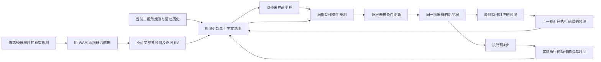

# DynamicWAM 分频架构完整设计

日期：2026-10-04。范围：DOMINO Level-1；先设计，不修改模型、训练配置或正在运行的实验。

本方案参考 AHA-WAM 的观测路由和偏移训练，保留 DynamicWAM 的视频—动作联合生成作为慢路径。核心目标是：在计入重刷新开销后提高动作更新频率，同时让当前观测、已执行动作和候选动作共同决定快路径使用的世界上下文。是否保留任务性能由成对评测决定，不能由模块连接形式或训练 loss 推出。

## 1. 设计判断

“慢世界模型、快动作模型、跨查询复用上下文”的核心思想与 AHA-WAM 相同，不应把分频本身作为新的贡献。值得研究的差别是：动态目标与接触切换下，旧预测如何根据实际执行和新观测得到校正；下一段动作改变后，预测是否仍与动作一致；这些处理能否在固定计算预算内带来可重复的控制收益。

建议采用一条统一主线：

**慢 WAM 提供参考预测；快路径先以真实观测校正当前状态，再以候选动作更新局部未来；动作网络读取校正后的同一份世界上下文。**

实现顺序为“保留容量验证机制 → 单独压缩采样步数 → 必要时再压缩网络”。当前独立小策略和两次端点预测保留为对照，不能提前认定它已经保留官方 WAM 的能力。

## 2. AHA-WAM 中采用什么

| 机制 | 本方案的采用方式 |
|---|---|
| 最新观测修正缓存 | 采用逐层、门控的 K/V 残差路由；每次动作查询重新计算 |
| Planner/executor 偏移训练 | 采用，并扩展到真实执行历史、完整缓存年龄分布与不同到达延迟 |
| 滚动观测记忆 | 先放在轻量观测路径中；不直接给未训练的原视频网络塞入历史 K/V |
| 未来预测主要作为训练监督 | 作为必须比较的简化基线；主方案仍保留显式的局部动作条件预测 |
| 少步蒸馏和推理优化 | 与分频分开实施、分开报告收益 |

AHA-WAM 的公开代码通过最新图像生成32个路由 query，再产生与原 K/V 等尺寸的残差；它没有把整个视频缓存缩成32个 token。[OVCR 实现](https://github.com/serene-sivy/AHA-WAM/blob/471b9815738471d6e1758111b73a5198553c1817/src/ahawam/models/wan22/mot.py#L15)

其推理 `prefill_video()` 读取观测、语言和历史，`action=None`；未来视频预测路径在部署时移除。因此，观测路由与候选动作条件未来预测是两种不同机制。[视频路径](https://github.com/serene-sivy/AHA-WAM/blob/471b9815738471d6e1758111b73a5198553c1817/src/ahawam/models/wan22/ahawam.py#L372)

默认 RoboTwin 代码每两个16步动作段刷新视频上下文，执行器仍按队列串行调用；单 GPU 服务另用动作优先的事件循环，不能把“分频”“异步接口”“GPU 真正重叠”混为一谈。[仿真配置](https://github.com/serene-sivy/AHA-WAM/blob/471b9815738471d6e1758111b73a5198553c1817/configs/sim_robotwin.yaml)、[运行时](https://github.com/serene-sivy/AHA-WAM/blob/471b9815738471d6e1758111b73a5198553c1817/deploy/server/async_runtime.py)

## 3. 当前实现中尚未解决的问题

已对照 10.12.208.50 的当前文件哈希，以下分析对应现有反馈版本，不是早期 temporal 版本。

| 当前代码事实 | 影响 | 本方案处理 |
|---|---|---|
| 重路径每16个执行动作刷新；缓存仍受4动作和0.72秒限制 | 部分快查询整份屏蔽 WAM，上下文易退化为纯小策略 | 观测记忆和预测先验分离；按实际时间支持和预测误差控制先验使用 |
| 配对训练 `every_fast_queries=2`，部署重刷新比为4 | 训练主要覆盖0/4动作年龄；8/12处依靠 null 输入，未学会校正这些年龄的旧预测 | 训练完整部署年龄及真实延迟，取消用高比例 null 替代年龄覆盖 |
| `last_feedback_future` 只保存最终预测，未进入下一次状态更新 | 最终动作与预测在本次调用中对上了，但未形成跨查询的预测—观测校正 | 保存带动作版本和时间支持的 ForecastRecord；下一次只消费已执行前缀对应的预测 |
| 新增小策略为384维、4层，原动作专家为768维、12层 | 容量变化、表征压缩、分频和采样变化同时发生 | 原动作专家作为机制验证与首选生产骨干；小策略单独作为压缩实验 |
| 两次端点调用都从同一初始噪声和起始时间预测 | 不是原10步采样的自然两步近似 | 先恢复标准时间调度，再做具有明确中间噪声时刻的少步蒸馏 |
| 未来标签池化成两个4×4空间网格 | 小物体运动或接触局部变化可能被均值淹没；这是待验证风险 | 保留原未来 latent 网格监督，增加明确时间点的观测预测标签 |
| 时间解释含固定 `temporal_seconds_per_action=0.15` | 示教帧、动作编号、仿真时间和墙钟时间可能被混用 | 每项显式记录时间来源，不把固定换算当作实际时间 |

代码入口：`src/dynamicwam/models/{causal_world_bridge,compact_fast_policy,action_feedback,temporal_world_memory,multirate_wam}.py`、`src/dynamicwam/runtime/ciwam/wam/multirate_policy.py`、`configs/feedback_policy_7gpu.yaml`。

还要特别注意：原 WAM 的联合注意力会混合视频与动作信息。深层“condition token”不等于纯观测 token，第二次联合前向导出的 K/V 也不等于干净的真实未来。**不能仅按 condition/future 的网格位置，把前者永久视为可信历史、后者视为可直接平移的物理状态。**

## 4. 统一架构和信息接口

### 4.1 三类状态必须分开

**ObservationMemory：已发生的事实。** 保存最近4次快查询的轻量三视角观测 token、运动有效性、机器人状态，以及期间实际执行的命令。来自真实观测，不从生成视频补历史；按观测 ID 去重。4是初始容量，后续比较1/2/4，不先扩成长记忆。

**WorldAnchor：慢路径的参考预测。** 保留原 WAM 的两次联合前向、原注意力和官方权重初始化。发布不可变逐层 K/V、来源观测 ID、来源仿真时间、噪声/采样版本、视频噪声级别及预测支持区间。它是有限支持的模型先验，不能在过期后重新标注为未来。

**ForecastRecord：快路径对某个动作计划的预测。** 保存最终动作 ID、预测起点、每项预测的时间支持和不确定性指标。下一次查询只比较实际执行部分；被丢弃的未执行动作后缀，不能当成已经发生的状态变化。

### 4.2 当前状态更新

记当前状态表征为 b_t，它由最新观测、观测记忆、已执行动作和可比较的上一轮预测得到：

`b_t = Update(observations_≤t, executed_actions, matching_previous_forecast)`。

第一版使用有界窗口的注意力融合，不引入无限递归的隐藏状态。上一轮预测的作用是提供“预期与实际的差异”；新观测始终保留直接输入通路。缺少可比较预测、预测尚未覆盖到当前时刻或执行时序不匹配时，显式 mask 该差异项。

可以将它解释为对当前隐状态的学习式估计，但在没有分布校准前，不称其为严格贝叶斯后验或具有覆盖保证的信念分布。

### 4.3 观测驱动的逐层更新

以 AHA-WAM 的32 query 为起始配置，由 b_t 和最新图像构建路由查询。每一层读取 WorldAnchor，再用低秩残差产生该查询独有的 K/V：

`C_obs,t[l] = Route(C_anchor[l], b_t, source_age, support_mask)`。

保留原缓存，只新建本次查询的视图；不原地改写、不二次施加原视频 RoPE。路由器采用零输出初始化和小门控，避免一开始就破坏原动作接口。这个门控初值只是优化策略，不等于效果保证。

到期的预测区间失去“未来支持”资格。ObservationMemory 仍可用；若实现保留过期 WorldAnchor 作为辅助上下文，必须明确标为旧先验并接受独立消融，不能悄悄当作有效未来。超过训练支持范围的缓存完全屏蔽。

### 4.4 动作条件预测怎样真正接入动作网络

路由器同时输出它已读出的紧凑世界特征 r_t，供动作 adapter 与局部预测器共享；不再额外跑一次视频网络或另建一个与 WAM 无关的观测编码器。局部预测同时读取当前状态和这份经过观测校正的世界特征：

`F_t(A) = Dynamics(b_t, r_t, ordered_action_sequence, action_timestamps)`。

预测器输出通过逐层 adapter 更新动作专家读取的世界上下文：`C_plan,t[l] = C_obs,t[l] + gated_projection_l(F_t(A), r_t, b_t)`。因此，慢 WAM 的信息进入局部预测，局部预测又回到原动作专家的逐层世界接口。两类条件分工清楚：观测路由回答“现在发生了什么”，动作条件预测回答“这个动作计划接下来可能造成什么”。

首选动作骨干为原12层 Action DiT，保留原动作、状态和 motion 接口。新增 adapter 在所有动作层提供条件；可共享低维主干加层特定输出投影，避免照搬大规模全维度编辑器。先保留完整原始 K/V，待质量验证后再研究缓存 token 压缩。

这样保留的是权重容量与接口基础，**不是数学上保证原 WAM 行为完全不变**。跨观测缓存、局部预测与新采样路径仍需训练适配。

## 5. 未来表示和监督

### 5.1 保留现有标签的空间分辨率

已读取实际 packed shard：单样本 condition latent 为 `[48,2,24,20]`，future latent 为 `[48,2,12,10]`，动作是 `[16,14]`。当前把 future 从12×10池化到4×4，不应作为唯一监督。

主预测头输出原 `[48,2,12,10]` 网格；fp16 单样本约22.5 KiB。这是对已有 latent 标签的利用，不新增3D点云或逐样本完整 K/V 数据库。32个路由 query 与预测标签分辨率是两个独立选择，不能混为一谈。

基础损失包含每空间位置的标准化 latent 回归、时间变化损失。可用真实标签变化生成有上限、均值归一化的训练权重，以减轻背景主导；保留非零全局权重，静止但任务相关的物体不能被完全丢弃。变化权重只能作训练损失权重，不作为推理时可用的 oracle 掩膜。

### 5.2 增加能与下一次观测直接比较的预测

现有两个视频 latent 时间组具有 VAE 的时域感受野，不能武断地当成第8步、第16步的瞬时图像。为跨查询校正，另设轻量观测预测头，预测在执行第4/8/12/16个计划命令后、明确时间点的冻结视觉特征。

目标从已有 RGB 轨迹按真实时间索引编码，不重采普通演示。使用冻结的目标编码器；明确其视角、分辨率和预处理，预测与实际都在这个空间比较。缓存现有数据缺失的少量特征时采用容量受限的分片，不落盘12层完整教师 K/V。

若某时间点没有精确观测或命令结束时间，样本 mask；不通过任意插值伪造接触事件附近的真值。预测的不确定性第一版只作误差估计与门控特征，校准后才用于触发刷新。

### 5.3 动作条件性需要真实验证

专家数据通常每个状态只有一个后续动作，预测器可能只凭观测就猜中专家未来，忽略动作。打乱动作后输出变化，不能证明变化方向正确；打乱动作而沿用原未来标签训练更是错误监督。

DOMINO 中目标的外加运动在接触前往往主要由外部运动过程决定，动作的作用集中在机器人运动、遮挡、接触和接触后的动力学切换。不能以“动作一变，所有物体的预测都要明显变化”作为成功标准。预测器可使用观测预测主干加动作条件残差，但是否受动作影响应由真实后果监督；评测分开报告接触前的外生运动预测与接触后的动作影响。

必须先核对原始自采数据中的动作究竟是实际下发命令、测得关节位置还是未来目标轨迹。若只是重采样的未来关节状态，本阶段应称“轨迹条件预测”，不能直接声称识别了执行器的动作因果效应。

若要验证偏离专家轨迹后的未来，第二阶段在 DOMINO 保存同一完整仿真状态与随机数状态，分支执行实际不同的短动作序列，记录各自真实后果。保持目标外加运动和接触后切换规则一致。先做小规模数据与评测可行性检查，不假定模拟器已经提供完整状态恢复接口。

## 6. 一个快查询的准确执行流程

基本时间尺度保持 `H_plan=16`、`H_exec=4`、`R_refresh=16 executed actions`。先固定，避免同时引入动态 chunk 选择。

1. 读取当前观测，汇总上次查询后实际执行的命令和时间。
2. 只消费时间匹配的 ForecastRecord，生成预测—观测差异，更新 b_t。
3. 按本次有效范围读取 WorldAnchor，执行观测路由，形成 C_obs,t。
4. 执行同一次动作采样的前半段，由当前带噪动作估计干净动作提议 A0。
5. 计算 F_t(A0)，形成当前动作计划对应的局部未来，再通过 adapter 修正后半程使用的上下文。
6. 完成采样得到 A1；计算 F_t(A1)，保存最终 ForecastRecord。
7. 原生 DOMINO 执行前4步；其余动作只是计划，不计入已执行历史。
8. 在下一次真实观测到来时重新校正。无需在一次查询内迭代至“动作—未来固定点”。

若 flow 参数化为 `x_sigma=(1-sigma)x0+sigma*epsilon`、网络输出 `v=epsilon-x0`，干净动作估计是 `x0_hat=x_sigma-sigma*v`。预测器接收 x0_hat，不把带噪动作直接解释成真实控制命令。

原10步路径用于先验证机制；蒸馏后默认候选为4步，在第2步后更新局部未来；2步版本在第1步后更新。**总共4或2次动作网络前向，并不是两轮完整的4步采样。** 最终预测更新计入延迟。

最终 F_t(A1) 与 A1 对应，但 A1 是参考 F_t(A0) 生成的，仍可能存在两者不一致。记录动作修正量和预测差异；不宣称两轮计算已经收敛。额外迭代只有在独立预算和收益实验支持时再引入。

## 7. 数据配对与训练分布

训练样本扩展为同 episode 内的序列单元：

`(source observation, current observation, observed history, executed prefix, reference anchor, current action labels, future labels, all timestamps)`。

至少区分以下时钟：示教帧索引、已完成命令索引、仿真物理时间、请求发出/结果完成的墙钟时间。`global_downsample_rate=3` 仅用于离线标签索引；不等于每个在线动作一定消耗3帧或0.15秒。

R=16、H_exec=4 的串行部署覆盖0/4/8/12动作年龄。异步部署还要覆盖提交到安装之间的真实延迟与不整齐偏移。按有效时间索引构造偏移，不能仅把 action tensor 左移而不移动对应观测和状态。[AHA-WAM 偏移训练配置](https://github.com/serene-sivy/AHA-WAM/blob/471b9815738471d6e1758111b73a5198553c1817/configs/task/robotwin_ahawam_offset.yaml)

首版训练：部署年龄分层采样，额外抽取范围内的非4倍数相位；null 输入仅用于缺失/失效情况和10%起始 dropout，而非默认75%。10%是待验证的初始超参数。真实部署年龄分布记录后，再重加权训练。

每个训练单元展开2–4次快查询，初始使用真实执行前缀，之后加入本策略实际采集的 rollout。策略动作分支没有对应环境后果时，不允许把专家后果强行贴上去。训练/验证按 episode 划分，未来标签只进入损失或固定教师目标，不进入慢缓存和策略输入。

## 8. 分阶段训练及停止条件

| 阶段 | 训练内容 | 冻结/保留 | 放行条件 |
|---|---|---|---|
| T0 基线与接口验证 | 不训练；官方 full H16/H4、当前反馈版、统一计时与种子 | 所有现有权重 | 确认 baseline、统计口径、索引和缓存边界 |
| T1 观测路由 | 当前观测编码、历史融合、逐层 router；必要时动作层轻量 adapter | 原视频与动作主干先冻结；保持10步采样 | 完整年龄验证、旧缓存校正优于直接复用，闭环质量达标 |
| T2 局部预测 | b_t 对齐后固定编码器，训练未来 latent 和明确时间点的观测预测头 | 视频、目标编码器和动作主干冻结 | 优于观测-only预测基线；动作条件收益不能只靠输入扰动响应判定 |
| T3 动作与未来耦合 | 训练预测到动作层的 adapter，逐步开放原动作专家 | 初期固定预测器及其输入编码器 | 反馈比容量/计算匹配的无反馈对照更好，保留原生路径质量 |
| T4 采样蒸馏 | 完整当前观测教师提供轨迹；10→4→2步独立检查 | 视频冻结，固定教师 | 成功率非劣与含重刷新开销的速度要求同时通过 |
| T5 可选小模型 | 蒸馏完整通过验证的策略到当前4层小策略 | 与分频机制分开 | 压缩后仍达到质量界限，否则保留原动作骨干 |

T1 损失以专家动作 flow loss 和固定官方教师行为对齐为主。上下文蒸馏优先比较其在固定探针 action query 上产生的注意力输出，不仅比较逐元素 K/V；多峰教师必须固定采样噪声或比较分布，避免把互斥动作平均化。

T2 的真实未来损失与策略损失分开。T3 起始阶段阻断“动作损失经预测器反传到动作提议”的梯度，防止策略利用预测器误差；预测器对当前候选动作的条件作用仍保留在前向路径。只有分支数据支持、错误外推受控后，才试验这一梯度路径。

T4 教师输入只有当前及历史可用观测，不使用真实未来。学生按其部署时的预测更新位置训练，不能用每步都有新世界上下文的教师输入偷换学生输入。通过多噪声锚点的端点/轨迹蒸馏，再按真实4/2步调度展开验证。

Stage1 无需立即重训：主方案不改变视频主干与 VAE 的原生结构。T1–T4 是新的适配与蒸馏流程，不应把旧 stage2/stage3 权重“继续几步”当作完成。若后续改视频因果 mask、输入历史或预测范围，则需要单独的视频适配训练，届时不能继续承诺完全跳过视频训练。

不先拍定总步数。按实际全局 batch、独立 episode 覆盖、验证曲线和闭环 gate 决定预算；记录样本曝光量。已有7卡训练继续产出对照证据，本设计不替换或中断它。

## 9. 延迟预算与刷新机制

令 C_world 为一次重刷新服务时间，C_fast 包含观测编码、路由、全部动作前向、两次局部预测与输出转换。端到端版本另将图像预处理、光流/运动特征构造和通信纳入相同口径；不能新旧两组采用不同边界。H_exec=4、每16动作刷新时：

`C_per_action = C_world / 16 + C_fast / 4`。

以此前固定输入测量 C_world≈203 ms、原同步H16约385 ms/查询为预算例子，若希望摊销成本低于原H16：

`C_fast < (385 - 203) / 4 ≈ 45.5 ms`。

这是预算上限，不是新架构实测承诺。保留原动作专家后，4步或2步是否满足它必须实测；不达标就继续优化或明确报告质量—速度权衡，不能通过把刷新推到未训练的更长周期“凑达标”。

第一轮使用串行固定预算，完整统计重刷新。观测误差门控先只决定缓存使用，不改变重刷新次数，从而单独检验模型改动。第二轮才加入事件刷新：维护最多一个待执行刷新请求，采用有上限的刷新额度，紧急刷新替代后续计划刷新，统计长窗口总开销。

突然接触、目标轨迹改变、观测丢失等事件只能依据策略可见观测构造信号。需要紧急回退完整 WAM 时明确计为超预算回退；回退比例过高就说明分频假设不成立。不能同时承诺任意突变即时重算和严格固定重计算预算。

所有 gate 都同时看三种结果：每执行动作的模型服务时间、端到端 episode 时间、查询p50/p95及刷新尖峰。单GPU异步需要实际竞争/重叠测量；双GPU单列资源成本。原生 DOMINO 会在查询时暂停物理仿真，其成功率不能验证真实墙钟延迟下的目标跟踪。

## 10. 连贯性与执行约束

输入实际执行的命令历史和当前本体状态，使策略知道当前处于上一段轨迹的哪里。动作命令类型保持现有绝对关节目标；比较轨迹时按实际执行时间对齐。

重规划时未执行的后缀可作为带有效性标记的参考，而不是硬锁定。已进入控制器、无法撤销的前缀才需要硬约束；原生同步 Level-1 通常没有这种并发提交前缀，不借机引入 RTC。

连续性损失约束边界的目标速度/加速度，但不强迫新动作追随已经失效的旧预测；接触或新的运动证据出现时允许修正。抖动指标使用真实时间差，并与跟踪误差、成功率同时报告，防止“动作几乎不动”获得好看的平滑度。

## 11. 代码改动清单

| 位置 | 计划改动 |
|---|---|
| `models/multirate_types.py` | 增加 ObservationMemory、WorldAnchor 元信息、ForecastRecord 和分离的时钟字段；schema升级、严格加载 |
| `models/causal_world_bridge.py` | 保留原两次联合前向；公开噪声/时间/支持信息；为数值等价测试提供精确的动作中间状态 |
| 新 `models/observation_world_router.py` | 最新观测与执行历史构造query、逐层门控更新、有效区间处理；不原地写缓存 |
| `models/action_feedback.py` | 原网格未来头、明确时间点的观测预测头、动作时间输入；预测误差校准与条件性验证 |
| `models/action_core_ops.py` | 原 Action DiT 读取本次路由后缓存；把不随采样步变化的计算移出循环 |
| `models/multirate_wam.py` | 前后半程处于同一采样轨迹；显式反馈位置；分阶段可训练参数与前向损失 |
| `models/compact_fast_policy.py` | 保留旧结果复现；后续作为T5压缩学生，不作为机制验证唯一骨干 |
| `training/data/paired_*` | 源—当前—执行前缀—后果的序列配对、完整年龄采样、标签时间支持审计 |
| `training/train/multirate_trainer.py` | T1–T4阶段合同、固定教师、序列展开、冻结与梯度路径检查 |
| `runtime/.../multirate_policy.py` | 保存真实执行日志与 ForecastRecord；消费对应前缀，安装不可变慢缓存，固定刷新额度 |
| `runtime/.../fast_slow_worker.py` | episode/generation/source去重，丢弃旧结果，最多一个待执行任务；并发版本独立验收 |
| `evaluation`、`scripts` | 成对清单、预测有效性、世界上下文利用率、预算及接触前后指标 |

零年龄、同噪声、router关闭的“原生等价检查”，必须从原联合去噪实际中间动作状态继续采样；从全新噪声读取第二步缓存并跑10步不满足等价条件。缓存压缩、少步采样、观测修正打开后的路径另做行为验证。

检查点记录：视频/动作/编码器身份、数据与归一化哈希、时间支持、采样时间表、预测头类型、路由层、执行长度、刷新预算、训练年龄范围、有效性阈值。参数缺失或合同不匹配时拒绝静默部署。

## 12. 决定是否值得保留的实验

采用逐步实验，不一开始把所有新模块和加速一起打开。

| 组别 | 用来回答的问题 |
|---|---|
| 官方 full H16、H4 | 仅缩短执行段是否已经损害行为？ |
| 原容量、10步、缓存直接复用 | 分频本身的收益与退化是什么？ |
| 上组加观测路由与偏移训练 | AHA式适配能否补偿旧上下文？ |
| 再加观测历史/执行前缀 | 历史记忆是否超过单次最新观测？ |
| 再加显式动作条件预测 | 是否比只有观测路由更好？ |
| 相同结构、去掉动作条件并重新训练 | 预测收益究竟来自动作还是观测？ |
| 相同结构、禁用下一次预测校正 | 跨查询闭环是否超过一次内部反馈？ |
| 分别蒸馏4步、2步 | 速度来自哪里，代价有多大？ |
| 可选小策略蒸馏 | 参数压缩是否必要，是否造成额外退化？ |

仅推理时关闭未来反馈可以作干预诊断，不能替代重新训练、容量与计算匹配的无反馈模型。若动作条件预测没有带来稳定收益，主方案退回“观测路由＋偏移训练”，如实承认 AHA 式机制已足够，停止为差异性保留无效模块。

离线指标包括：按缓存年龄分层的动作误差、原网格/局部变化预测误差、按接触阶段的预测失配、动作条件与观测-only模型对照、有真实分支标签时的反事实排序/误差、被策略实际读取的有效预测比例。

闭环先用独立验证 seeds 做20 episodes/任务的试验筛选；冻结设计后使用新的固定测试清单覆盖全部35任务，正式非劣检验需要时扩至100 episodes/任务。不要把当前正在跑的评测当作新方案结果，也不使用测试结果反复调超参数。

预先建议成功率非劣界限为官方H16的3个百分点，报告成对差值置信区间；置信区间不足以判断时标记“不确定”。这只是验收界限提案，不是现有模型的结论。同时报告与原容量H4的匹配比较，分清缩短执行段和新架构的影响。

时延主门槛建议在同卡、相同计时范围下，含刷新成本的每动作服务时间至少降低20%；若单次查询更快但总成本不达标，不判为通过。完整 episode 时间需处理失败早终止的偏差，同时给出成功率、固定长度计算测试和成功任务完成时间。

## 13. 实施优先级与研究边界

先完成 T0/T1：核对四类时钟、原生接口等价、原动作容量下的观测路由和完整偏移训练。这一步最接近 AHA-WAM，有明确对照，也能避免把小策略能力不足误判为分频不可行。

再完成 T2/T3：把最终预测用于下一次真实观测校正，验证候选动作对未来预测的有效影响。专家数据先支持分布内预测；超出专家分布的动作预测需分支后果或策略 rollout 数据支持。

最后 T4/T5 压缩推理。达到速度并不保证维持质量，保留官方 WAM 权重也不保证新条件接口无损。可以投稿的主张应来自实验：在相同世界刷新预算、相同动作骨干和相同执行频率下，执行与观测校正后的局部未来能否改善动态目标控制；不能仅以多了一个反馈头或分频调度作为证据。

主要参考：[AHA-WAM 论文方法与附录](https://arxiv.org/html/2606.09811v1)。其中的高控制频率还依赖部署优化与采样蒸馏；本方案的性能与速度均需在当前 A6000/DOMINO 协议中重新验证。
