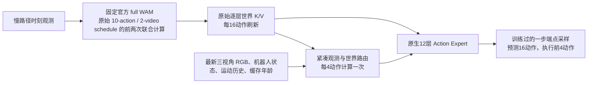

# 原生 Action Expert 分频：实现、训练与验收

本版主线：保留官方 WAM 的视频先验和原生 768 维、12 层动作网络，用最新观测更新动作条件，通过真正训练过的一步采样降低计算量。延迟和成功率分别验收，不能用训练 loss 代替闭环成功率。

## 1. 为什么必须同时改训练和推理

[AHA-WAM 论文](https://arxiv.org/abs/2606.09811)及[官方代码](https://github.com/serene-sivy/AHA-WAM)提供了可借鉴的两点：跨时间训练、用当前观测读取缓存的世界上下文。但这些机制本身并不能保证动态任务上的未来预测持续有效，也不保证计入刷新后的吞吐提高。

本项目上一版有三个混在一起的改变：缩小动作网络、缩短执行 chunk、重用旧世界缓存。这样即使变快或变差，也难以定位原因。本版删除主路径对独立小动作网络及未经充分验证的局部未来反馈头的依赖，旧实现保留供对照。

必须区分三个时钟：

- 视频更新周期：每执行 16 个动作，重新生成世界缓存。
- 闭环查询周期：每执行 4 个动作，读最新三相机、状态和运动历史。
- 一次查询的求解步数：stage2 用 10 步作为质量参考；stage3 专门训练 1 步端点采样。

官方 H=16 每个周期计算 2 次联合 video/action 和 8 次 action-only。H=4/R=4/K=2 仍然是 2+4×2=10 次 action expert，外加观测编码和路由，并没有降低动作网络调用数。因此正式主线采用 K=1：2+4×1=6 次；K=2 配置另存为消融。

## 2. 实际结构

`WorldAwareConditioner` 用当前观测读取旧缓存第 3/7/11 层，每层 16 个查询。原始世界 K/V 保持完整，继续供原生动作注意力读取；额外条件走 192 维残差注意力再映射回 768 维。残差输出零初始化。视觉编码使用 GroupNorm，不依赖推理 batch=1 的 BatchNorm 统计。

路由每次查询计算一次，不在去噪步内重复执行，也不把紧凑查询重新展开成全长 2048 维世界缓存。缓存年龄、真实模拟时间差、机器人状态变化都作为条件。

**固定视频权重还不够。** 联合注意力中的动作网络变动也会改变视频缓存。因此训练和部署均用独立、不可变的官方 full WAM 生成慢路径缓存；快动作网络单独训练。checkpoint 保存该官方模型的路径与 SHA-256，部署校验后加载，不能悄悄使用训练后的快专家来生成慢缓存。

**本版更新的是供动作使用的世界条件，不是每4动作重新生成完整视频。** 它没有证明任意新候选动作的反事实未来预测。旧未来可能不再准确，所以仅训练和部署明确覆盖的年龄，并用当前观测纠正动作；不能把缓存的某个 VAE 时间格当成精确未来时间点。若动态任务需要更频繁的完整世界更新，应由闭环评测证明，不能在快路径宣称已经解决。

## 3. 训练配方与数据

复用现有与官方格式对齐的 DOMINO level-1 自采数据：`data/packed/domino_absolute_motion_v2` 和对应 exact-time 源数据。没有重采 RGB-D、重打包视频或新增视频输入。原始 condition/future latent、动作统计、运动特征语义保持一致，因此**本轮不重训 stage1**。

| 阶段 | 初始化 | 可训练部分 | 目标 | 正式预算 |
|---|---|---|---|---|
| stage2 / adapt | 官方 full | 原生 action、motion、观测/世界路由 | 演示动作 flow matching + 独立官方教师动作轨迹的 flow matching | 7000 optimizer steps |
| stage3 / distill | 本轮 stage2 | 同上，视频继续冻结 | 实际1步 sampler 末端对官方教师轨迹的 MSE + 0.1 演示末端监督 + 0.1 FM anchor | 3500 optimizer steps |

7 卡 × 每卡 batch1 × 累积2 = global batch14，分别为 98,000 / 49,000 个样本呈现量；这是本轮明确实验预算，并不等于完整遍历全部可用跨时间样本。stage3 是新优化器的新训练阶段，不是恢复 stage2 的 optimizer。

训练缓存年龄为 **0/4/8/12 个动作**，对应原始帧 offset **0/12/24/36**。episode 级 train/validation 划分不变；年龄均衡采样，null bridge 比例 10%。不再只训练 0/4 却部署到 12，也不再到 4 步或 0.72 秒就清空整份未来缓存。无固定秒 TTL 不代表任意延迟有效：秒数仍作为输入，分布外长执行时间必须在后续真实部署中另行评估。

噪声分成三份：旧世界桥噪声、当前快采样噪声、教师轨迹的 FM 加噪。前两者独立，和实际部署一致；当前教师与学生共享快采样初始噪声；FM 加噪独立于教师生成噪声。教师只看当前及历史观测，GT future latent 不能进入生成缓存/教师的条件。

stage3 直接反传实际部署的一步 Euler 末端，不是仅训练随机时间的 FM 后把推理步数改成 1。慢路径 schedule 固定为官方 10/2，快 schedule 单独保存并严格校验。仅残差零初始化不意味着整个分频 sampler 与官方 sampler 数值等价。

## 4. 延迟与质量的提前验收

完整序列脚本：`scripts/run_native_pipeline.py`。

1. 15 项 tiny CPU 契约检查；GPU dense attention 前向和梯度对齐。
2. 7卡 stage2/stage3 各2步，验证 backward、保存、严格加载、冻结视频参数逐项相等。
3. 空闲 GPU 下测至少20次完整快查询、慢桥、官方 H16；包含 RGB 编码、路由、动作采样和取回结果。固定合成输入仅用于计算预算，不证明成功率或真实端到端延迟。
4. 200步 stage2 + 200步 stage3 pilot，按0/4/8/12分别报告教师误差、演示误差、前4动作误差及 null-cache 对照。
5. 三任务、各2个配对 seed 的实际模拟探针。这里只验证功能、配对和延迟，不能由6个episodes断言质量非劣。
6. 正式7000/3500步，再用35个官方任务×每任务20episodes评估官方H16、官方H4、stage2 H4、stage3 H4，所有组共享seed清单。

令慢桥时间为 B、一次完整快查询为 F、官方完整查询为 C：

`新方案 ms/action = B/16 + F/4`；`官方 H16 ms/action = C/16`。

长训前的计算预算 gate 要求：相对官方默认精度 H16 至少下降20%，相对 BF16 动作专家 H16 至少下降10%，快查询 p95 < 100ms。还需报告快查询、刷新查询峰值、实际 bridge 次数和真实 episodes 中的 ms/action，不能只汇报 F。

原生动作注意力无填充路径改用 dense FlashAttention，避免通用 varlen wrapper 用 GPU 长度切片带来的逐层 host 同步。该优化也用于官方对照。官方默认动作参数为 FP32、独立快专家为 BF16，故额外报告匹配精度的对照；BF16 官方对照也改变联合前缀算术，其任务质量仍需独立验证。源码 profiler 的步数 override 只允许测试计算下限，不能作为训练过的策略或质量证据，pipeline 明确拒收。

第一轮空闲 A6000 测量得到 B=181.37 ms、F=22.01 ms、C=314.50 ms，摊销仅下降14.34%，未达到20%门槛，因此没有继续长训。随后增加 `inference/native_fast_graph.py`：对冻结推理网络捕获观测路由及完整的一步/两步动作采样，每次查询将 RGB、state、motion、mask、年龄、text、noise 和世界 K/V 复制到图的独立输入缓冲。输出 clone，防止后续重放改写已交付动作；输入形状变化时重新捕获，捕获失败直接报错。

CUDA Graph 改的是 GPU 算子提交方式，不改训练公式或模型参数。训练环境和 DOMINO 的 Python3.10 环境均完成12类输入切换验证，graph 与 eager 的归一化动作在这些用例中最大差异为0。训练环境采样核心约20.1→5.7 ms，评测环境约20.2→6.0 ms；这是采样核心耗时，仍需完整预算验收。首次捕获约1–2秒，须单列冷启动，不能把它算作稳态延迟。Graph只用于原生K1/K2推理，stage2 K10保持普通执行。

总提速包含少步蒸馏和执行引擎优化两部分，不能全部归因于分频本身；官方对照共享dense attention优化但未使用CUDA Graph。已有无Graph测量作为消融证据，后续若报告纯架构收益还需对齐执行引擎。真实episode统计保留首次捕获和慢刷新开销。

2026-10-04，空闲 A6000、每条路径20次、K1两步训练 smoke checkpoint 的完整计算预检结果：

| 指标 | 测量结果 |
|---|---:|
| 慢桥 B | 181.22 ms |
| 完整快查询 F（含当前RGB路由和动作取回） | 7.63 ms，p95 7.65 ms |
| 官方默认完整查询 C | 305.41 ms |
| 新方案摊销 B/16+F/4 | 13.23 ms/动作 |
| 官方 H16 摊销 | 19.09 ms/动作 |
| 官方 BF16 action/motion H16 摊销 | 19.20 ms/动作 |
| 相对官方默认 H16 的耗时下降 | 30.67% |

两个精度对照均通过门槛。该测量使用只训练过2个 optimizer steps 的 smoke 权重，只验证实际架构/求解器的计算可行性，不能说明一步策略已学好。稳态测量排除首次1.32秒图捕获、渲染、光流构造、动作执行和IPC；慢刷新仍是串行阻塞。正式训练后真实episode必须重测。

当前 DOMINO 主线使用 `controlled_ratio`：动作执行与推理遵循 native benchmark 的串行协议。它是跨查询的快慢计算分频，**本轮不宣称实现真实异步控制/RTC**。旧 independent worker 实际会每12动作预取桥，违反16动作预算，因此 native 模式明确拒绝它。以后接 RTC 必须重新设计发布时间、执行延迟和训练年龄覆盖。

## 5. 交付边界与证据位置

- 源码主要入口：`models/world_aware_conditioner.py`、`models/multirate_wam.py`、`training/train/multirate_trainer.py`、`inference/fast_runtime.py`、`runtime/ciwam/wam/multirate_policy.py`，均位于 `src/dynamicwam`。
- 配方：`configs/multirate/native_stage2_7gpu.yaml`、`native_stage3_7gpu.yaml`；`*_2step.yaml` 保留两步消融。
- 短训练证据：`/SSD_DISK/users/wuruihan/DynamicWAM/outputs/evaluation/native_preflight_20261004/`。
- 首轮未通过预算门槛的证据：`/SSD_DISK/users/wuruihan/DynamicWAM/outputs/evaluation/native_20261004/`，保留不覆盖。
- CUDA Graph版本完整流程和日志：`/SSD_DISK/users/wuruihan/DynamicWAM/outputs/evaluation/native_graph_20261004/`，以 `status.json` 和 `evaluation_summary.json` 为准。
- 已通过：15项CPU契约；dense attention的3组GPU前向/梯度对齐，前向最大差异0.0009765625；七卡stage2、一步stage3及两步stage3各2步训练/验证/导出。stage2与一步stage3的339个视频相关张量逐项与官方权重相等，校验见 `checkpoint_verification.json`。
- Graph版本空闲GPU预算验收已通过，结果在 `native_graph_20261004/latency_preflight.json`。连续流程已启动，协调进程PID 2905416；启动后当前阶段为七卡 `pilot_stage2`，正式7000/3500步及四组eval尚未完成，最新进展以 `status.json` 为准。
- 成功率非劣和真实闭环提速尚未验证，不由训练loss、保留原网络宽度或微调初始化推出。少步蒸馏可能损失动作分布多样性，旧未来可能不适用于新动作，H4闭环也可能改变接触时序；四组配对评测用于分别识别缓存/路由、一步蒸馏和执行周期带来的影响。

脚本对失败阶段停止，不覆盖已有结果，不自动少跑一步或延长世界刷新周期。正式训练从本轮初始化按配方重训，pilot权重用于排错，不伪装成正式结果。
